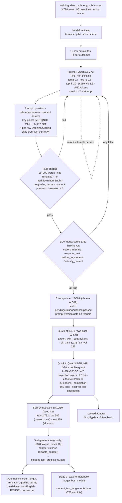

# Feedback generation

This repository trains a small model to write tutor feedback for short-answer
computer science questions. Given a question, the reference answer, the
student's answer, and which rubric key points were marked MET / NOT MET, the
model writes a short paragraph telling the student what they got right, what
is missing, and how to improve.

A large **teacher** model writes the training data, a small **student** model
is fine-tuned on it, and the teacher then acts as an **LLM judge** comparing
the student's base model against its own adapter:

| Stage | Notebook | Model | What it does |
|---|---|---|---|
| 1. Teacher | [feedback_teacher_qwen3.5-27B.ipynb](feedback_teacher_qwen3.5-27B.ipynb) | Qwen3.5-27B-FP8 (offline vLLM) | Writes feedback for all 3,778 rows and keeps only feedback that passes rule checks and an LLM judge. |
| 2. Student | [qlora_feedback_qwen3.5-9B.ipynb](qlora_feedback_qwen3.5-9B.ipynb) | Qwen3.5-9B with QLoRA | Fine-tunes on the kept teacher feedback, then generates feedback for the unseen test set with and without the adapter. |
| 3. Judge | Last section of the teacher notebook | Qwen3.5-27B-FP8 (thinking mode) | Judges every test-row feedback from both models with the same four checks the teacher's drafts had to pass. |

The trained adapter is published on Hugging Face at `SmuFypTeam5/feedback`
(served as `qwen35-9b-feedback-qlora` in the deployment; see the
[deployment repository](../deployment) for serving).

## Pipeline



## Results

Measured on 389 test rows from the 10 held-out questions (questions neither
training nor validation used).

| | Base Qwen3.5-9B | With feedback adapter |
|---|---|---|
| **Passes all four judge checks** | 79.7% | **89.7%** |
| Covers every missing key point | 94.9% | 97.2% |
| Does not treat a met key point as missing | 95.4% | 97.2% |
| Faithful to what the student wrote | 86.9% | 95.9% |
| Factually correct | 88.2% | 95.4% |
| Passes the format checks (no markdown, grading terms or overlong text) | 44.2% | 100% |
| ROUGE-L against the teacher's feedback | 0.299 | 0.392 |
| Mean length (words) | 90 | 70 |

The first five rows come from the Qwen3.5-27B judge; the last three are the
automatic checks the student notebook computed. Every value reproduces from
`Datasets/teacher_feedback/student_test_judgements.jsonl`.

To see what the numbers mean in practice, read
[Results/side_by_side_examples.md](Results/side_by_side_examples.md) — eight
test rows with both models' feedback, including two where the adapter did
worse.

## Where to find things

```
feedback/
├── feedback_teacher_qwen3.5-27B.ipynb   Stage 1 and 3, saved with its outputs
├── qlora_feedback_qwen3.5-9B.ipynb      Stage 2, saved without outputs
├── Datasets/
│   ├── training_data_moh_eng_rubrics.csv    Source data
│   └── teacher_feedback/                    Everything the pipeline produced
├── Results/
│   └── side_by_side_examples.md             Base vs adapter on eight test rows
└── Archive/                                 Earlier experiments, not part of the final pipeline
```

| If you want to see | Look at |
|---|---|
| The teacher and judge prompts | Teacher notebook, section *Prompts* |
| The rule checks and their exact thresholds | Teacher notebook, sections *Prompts* and *Quality checks* |
| How much teacher feedback passed, and why the rest failed | Teacher notebook, section *Review* |
| The student prompt and LoRA settings | Student notebook, sections *Configuration* and *Prompt* |
| How the automatic checks are computed | Student notebook, section *Generation and automatic checks* |
| The judge's verdict on every test row | `Datasets/teacher_feedback/student_test_judgements.jsonl` |

## Data

**Source:** `Datasets/training_data_moh_eng_rubrics.csv` has 3,778 graded
student answers to 95 questions. Each row has the question, the reference
answer (`desired_answer`), the student's answer, the rubric key points
(`criteria[]`), the mark for each point (`criteria_score[]`), the point
maximums (`criteria_max_score[]`), and the student's total
(`student_score`).

**Pipeline outputs** in `Datasets/teacher_feedback/`:

| File | Contents |
|---|---|
| `training_data_moh_eng_rubrics_with_feedback.csv` | The source data plus `feedback` and `feedback_passed_checks` (3,533 / 245). This is the student's training data. |
| `training_data_moh_eng_rubrics_generations.jsonl` | Every draft the teacher wrote (6,308), with attempt, style and rule-check result. |
| `training_data_moh_eng_rubrics_judgements.jsonl` | Every judge verdict on those drafts (4,037). |
| `student_test_judgements.jsonl` | Feedback from the base model and the adapter on the 389 test rows, with the judge's verdict on each (778 records). |
| `sft_train.jsonl`, `sft_val.jsonl` | The teacher feedback in chat format with a question-level split (10 of 95 questions held out → 3,238 / 295 rows). Not used by the student notebook, which splits the same rows by question itself. |

`student_test_predictions.jsonl` (raw test generations) is not committed; the
same feedback text is in `student_test_judgements.jsonl`.

## Method

**Teacher.** For each row the teacher writes one paragraph of feedback.
Every draft must pass two gates:

- **Rule checks:** truncation, 15–200 words, no markdown, no CJK/Korean
  text, no grading vocabulary ("rubric", "criterion", "marks", "reference
  answer", …), no stock phrases ("You correctly…", "However, your answer
  missed…", "Next time, be sure to"), and at most one "However".
- **LLM judge:** the same 27B model in thinking mode, with a separate
  auditing prompt. It checks four things: every missing point is covered, no
  met point is treated as missing, the student is not credited with
  something they didn't write, and the technical content is correct.

A failed row is regenerated with a new seed (`42 + attempt`) and a redrawn
opening/closing style, up to 4 attempts. Generation and judging run in
chunks of 512 rows with JSONL checkpointing after each chunk; on resume only
records matching the current prompt/model version are reused. In the
recorded run, 3,533 of 3,778 rows (93.5%) passed (attempts used: 2,319 × 1,
769 × 2, 309 × 3, 381 × 4). Only these are used to train the student.

**Student.** QLoRA on Qwen3.5-9B: 4-bit NF4 base model with double
quantization, LoRA rank 16 / alpha 32 / dropout 0.05 on the q/k/v/o and
gate/up/down projections of the text layers, learning rate 1e-4 with
plateau reduction, effective batch 16, up to 3 epochs, loss on the feedback
text only (thinking disabled), and the checkpoint with the lowest
validation loss kept (early stopping patience 4). Questions are split
80/10/10 with seed 42 — all answers to a question stay in one split —
giving 2,782 training rows, 386 validation rows and 389 test rows
(testing uses all 389 rows, including 24 without teacher feedback, so their
ROUGE-L is undefined).

The base model and the question split are the same as the grading adapter's
(in the project's [`qlora/`](../qlora) folder). One vLLM server can therefore
serve both adapters, and both are tested on the same unseen questions.

**Judge.** The student's test-set feedback goes through the same four judge
checks the teacher's feedback had to pass. The base model gets the same
prompt and decoding settings as the adapter, so the comparison isolates the
effect of fine-tuning.

## Reproducing

Both notebooks need a Linux machine with a CUDA GPU. They were run on one
NVIDIA L40S (48 GB). Use a separate Python environment for each, because
vLLM pins its own PyTorch build.

1. Run the teacher notebook up to *Export*. Generation and judging are
   checkpointed, so an interrupted run resumes where it stopped (a prompt
   change invalidates the stored records by design).
2. Run the student notebook. It trains the adapter, writes the test-set
   feedback to `Datasets/teacher_feedback/student_test_predictions.jsonl`
   and uploads the adapter.
3. Run the teacher notebook again. Finished rows are reused, and the last
   section judges the student's feedback.

Run the notebooks from this folder or from its parent folder. For a
non-interactive run (such as papermill), set `HF_TOKEN` before the upload
step.

## Archive

Earlier prompting experiments on older datasets, kept for reference. They
are not part of the final pipeline, and their notebooks still point to the
file paths used at the time.

| Path | Contents |
|---|---|
| `Archive/Qwen3.5-4B/` | First attempt: Qwen3.5-4B prompted directly, with its 50 sample outputs. |
| `Archive/Qwen3.5-9B/` | Qwen3.5-9B prompted directly with two prompt versions. `prompt_A/` and `prompt_B/` each hold the prompt and its 50 sample outputs. |
| `Archive/Datasets/` | The older datasets these experiments used. |
